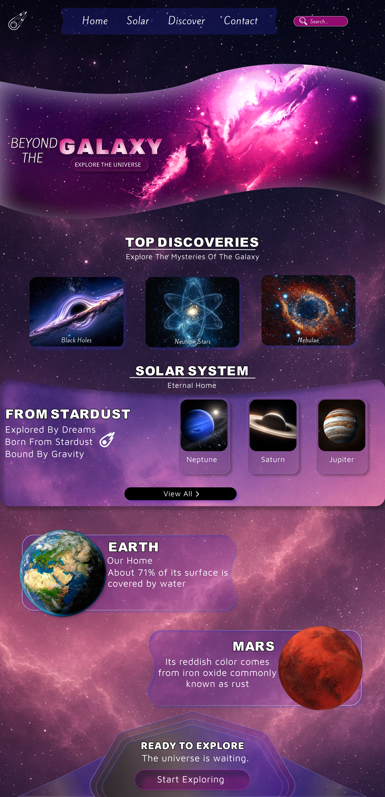
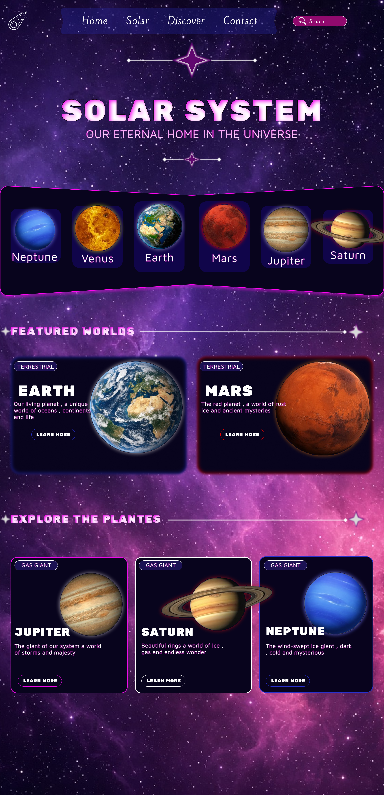

# 🌌 GALAXY — Space Exploration UI/UX Design

**An interactive space exploration website concept designed in Figma.**

GALAXY is a visually immersive website design inspired by the universe, galaxies, and space exploration. The project combines a cosmic visual identity with interactive interface elements to create an engaging user experience.

## 🚀 Project Overview

GALAXY is an interactive UI/UX design prototype featuring a collection of connected pages. Its visual direction is built around deep-space backgrounds, glowing elements, planetary imagery, and a purple-pink cosmic color palette.

The project focuses on visual storytelling, interface consistency, and intuitive navigation.

## ✨ Features

- **Interactive Hover Effects:** Visual feedback when users hover over interactive elements.
- **Page Navigation:** Connected pages with functional prototype navigation.
- **Interactive Buttons:** Clickable buttons and interface elements.
- **Cosmic Visual Identity:** A consistent space-inspired design system.
- **Multi-page Experience:** Four interconnected website pages.

## 🪐 Website Pages

### 1. Home Page

### 2. Discover Page

### 3. Solar System Page

### 4. Contact Page

## 🔗 Interactive Figma Prototype

Explore the interactive version of GALAXY:

[**Open GALAXY Interactive Prototype**](https://www.figma.com/design/Xi9eZmr7Tow7iP989fOXH5/GALAXY?node-id=0-1&t=Q2GIVKHD2PZS7hj2-1)

## 🛠️ Tools & Technologies

- Figma
- UI/UX Design
- Interactive Prototyping
- Visual Design

## 📌 Project Status

**Design Completed — Interactive Prototype Available**

This repository contains the visual design assets and interactive Figma prototype. It is currently a design project and does not include a coded website implementation.

## 👨‍🚀 Author

**AloneCry-official**

GitHub: [@AloneCry-official](https://github.com/AloneCry-official)
