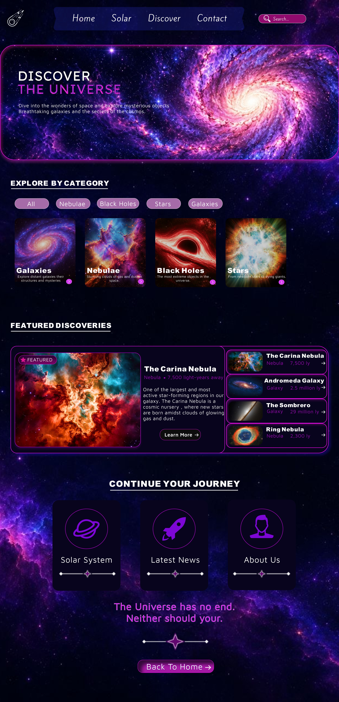
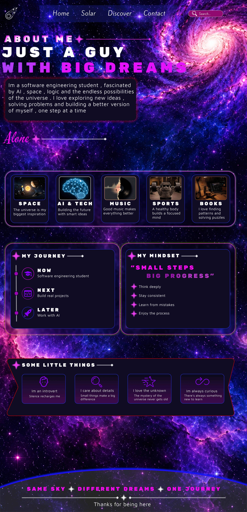

# 🌌 GALAXY — Space Exploration UI/UX Design

**An immersive, interactive space exploration website concept designed in Figma.**

GALAXY is a space-inspired UI/UX design project that transforms the experience of exploring the universe into a visually engaging digital journey.

Inspired by galaxies, cosmic environments, and planetary systems, GALAXY combines atmospheric backgrounds, glowing visual elements, and a purple-pink color palette to create a distinctive interface experience.

---

## 🚀 Project Overview

GALAXY is a multi-page website design prototype featuring four interconnected pages: Home, Discover, Solar System, and Contact.

The project focuses on creating an immersive visual experience through thoughtful interface design, interactive prototyping, and consistent visual storytelling.

Rather than being a coded website, GALAXY is an interactive Figma prototype that demonstrates the structure, appearance, and intended behavior of a space exploration website.

## ✨ Features

- **Interactive Hover Effects:** Visual feedback and animated interactions when hovering over selected interface elements.
- **Prototype Navigation:** Connected pages with interactive navigation between different sections.
- **Interactive Buttons:** Clickable buttons and interface elements within the Figma prototype.
- **Cosmic Visual Identity:** A consistent design language inspired by galaxies, planets, and deep space.
- **Multi-page Experience:** Four interconnected pages designed as one cohesive website concept.
- **Visual Storytelling:** Immersive layouts, planetary imagery, glowing effects, and atmospheric backgrounds.

## 🪐 Website Pages

### 1. Home Page
The main landing page introducing the GALAXY experience, featuring cosmic visuals and selected space discoveries.

### 2. Discover Page
An exploration-focused page presenting fascinating cosmic objects, galaxies, and space-related discoveries.

### 3. Solar System Page
A planetary exploration interface featuring the Solar System and selected planets.

### 4. Contact Page
A dedicated contact interface designed to complete the website experience.

## 🖼️ Project Screenshots

Explore the visual design of all four GALAXY pages.

### 🏠 Home Page

### 🔭 Discover Page

### 🪐 Solar System Page

### ✉️ Contact Page

---

## 🔗 Interactive Figma Prototype

Explore the complete interactive prototype, including page navigation, hover effects, and interactive interface elements.

**[🚀 Open GALAXY Interactive Prototype](https://www.figma.com/design/Xi9eZmr7Tow7iP989fOXH5/GALAXY?node-id=0-1&t=Q2GIVKHD2PZS7hj2-1)**

## 🛠️ Tools & Technologies

- **Figma** — Interface design and interactive prototyping
- **UI/UX Design** — User interface and experience design
- **Interactive Prototyping** — Navigation, hover interactions, and clickable elements
- **Visual Design** — Cosmic visual identity, layouts, and visual composition
- **GitHub** — Project documentation and design asset management

## 📌 Project Status

**Design Completed — Interactive Figma Prototype Available**

The GALAXY design and interactive prototype are completed.

This repository contains the project's visual assets, page screenshots, documentation, and Figma prototype link.

**Note:** This project currently focuses on UI/UX design and interactive prototyping. It does not include a coded or deployed website implementation.

---

## 👨‍🚀 Author

**AloneCry-official**

- GitHub: [@AloneCry-official](https://github.com/AloneCry-official)
- Project Repository: [GALAXY-UI-UX-Design](https://github.com/AloneCry-official/GALAXY-UI-UX-Design)

---

*Designed with curiosity, inspired by the universe. 🌌*
